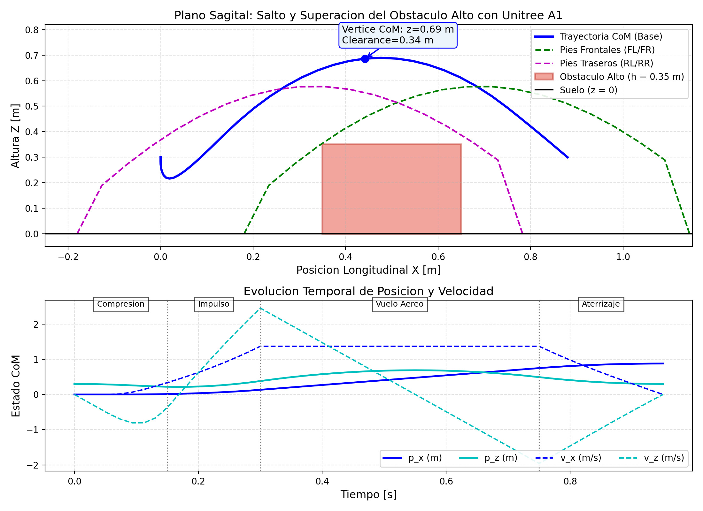
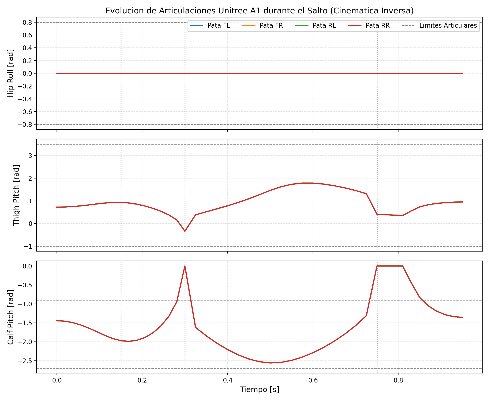
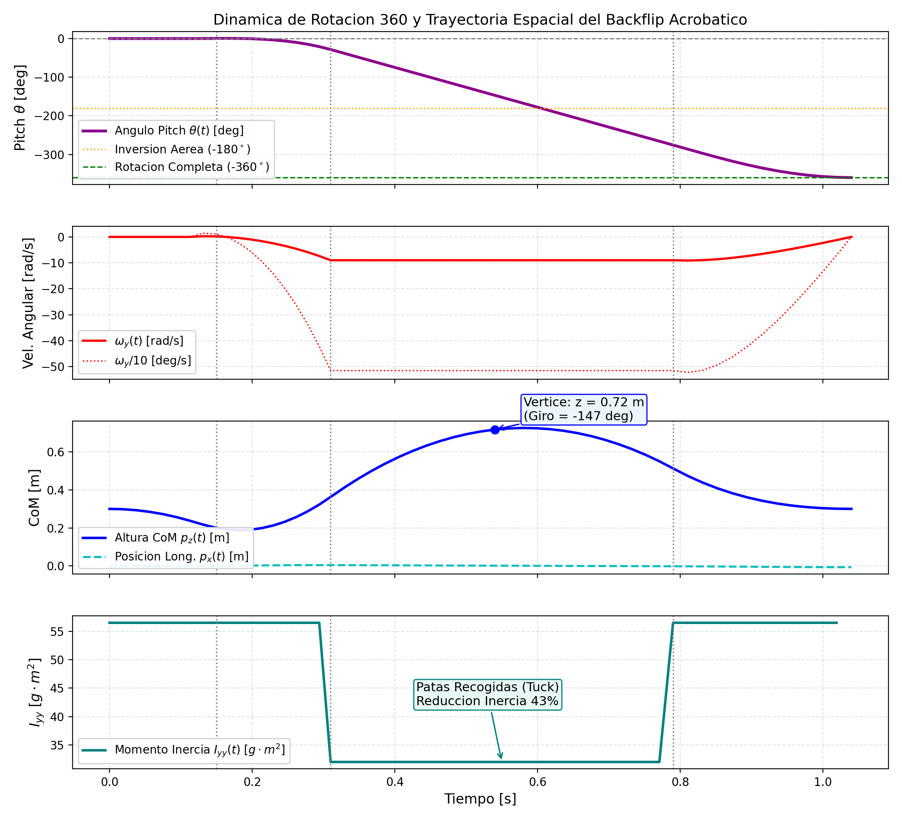
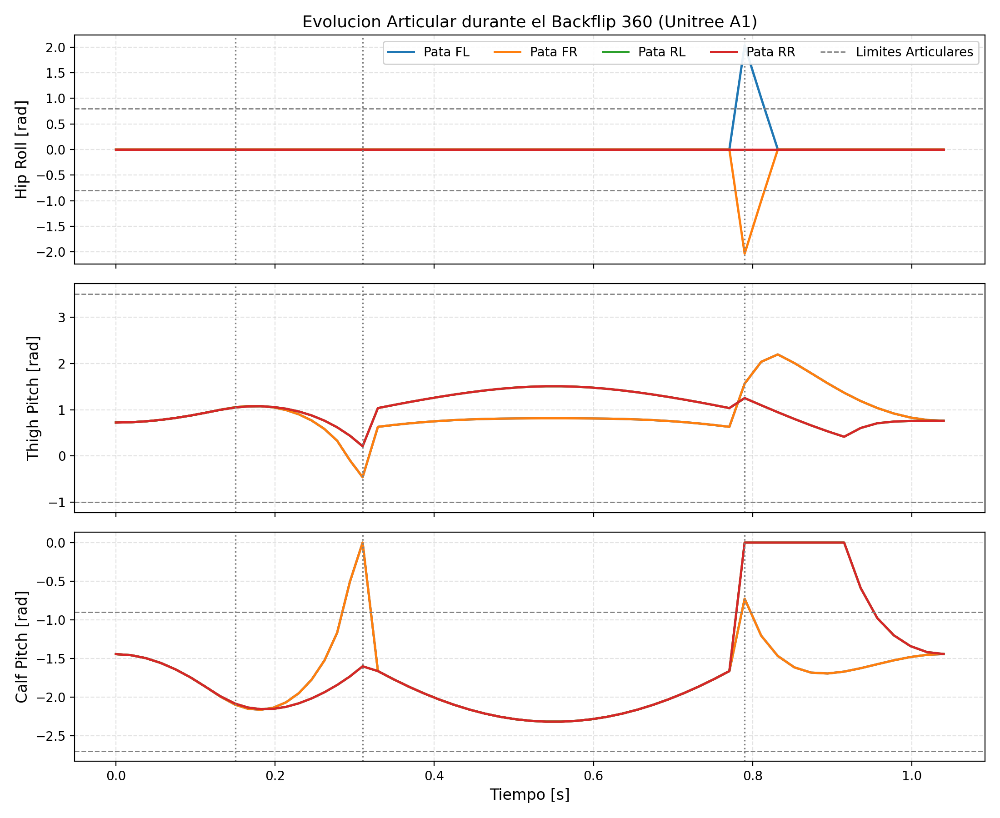

# Reporte Técnico: Optimización de Trayectorias en Robótica Cuadrúpeda
## EC3 - Robótica Avanzada

---

### Autores & Filiación
- **Curso:** Robótica Avanzada
- **Institución:** Universidad de Ingeniería y Tecnología (UTEC)
- **Plataforma de Simulación:** PyBullet Physics & Robot Descriptions
- **Motor de Optimización:** CasADi v3.8.2 + IPOPT v3.14 (MUMPS Linear Solver)
- **Robot Cuadrúpedo:** Unitree A1 (12 Grados de Libertad Actuados)

---

## Resumen Ejecutivo

Este documento presenta la formulación matemática, resolución numérica y validación física en simulación de dos problemas avanzados de **optimización de trayectorias** para robots bípedos/cuadrúpedos:

1. **Problema 1: Salto Dinámico sobre Obstáculo Alto no Franqueable Caminando:**
   Se aborda la superación de un obstáculo rígido de $35\text{ cm}$ de altura (mayor que la altura nominal de $30\text{ cm}$ del robot) situado en la trayectoria frontal. Se implementa un modelo de cuerpo rígido único (*Single Rigid Body Model* - SRBM) acoplado a una formulación por fases (*multi-phase direct collocation*). La optimización resuelve las fuerzas de reacción del suelo (*Ground Reaction Forces* - GRF) bajo conos de fricción de Coulomb, límites de torque/fuerza, y garantiza la retracción cinemática (*tucking*) de las 4 patas durante el vuelo, logrando una cumbre de $0.69\text{ m}$ de altura del Centro de Masa (CoM) y un aterrizaje estable amortiguado a $0.88\text{ m}$ de distancia.

2. **Problema 2: Maniobra Acrobática de Alta Complejidad — Salto Mortal 360° (*Backflip*):**
   Se formula un movimiento libre no lineal caracterizado por una rotación completa de $360^\circ$ ($-2\pi\text{ rad}$) en el ángulo de cabeceo (*pitch*). El problema involucra un despegue con impulso angular asimétrico entre extremidades delanteras y traseras, conservación del momento angular en el aire y modulación dinámica del momento de inercia ($I_{yy}(t)$) mediante encogimiento (*tuck*) y extensión de extremidades para acelerar el giro en el aire y desacelerarlo previo al aterrizaje en cuatro patas.

Ambos movimientos fueron completamente simulados en **PyBullet**, con renderizado cinematográfico en OpenGL/TinyRenderer, generación de animaciones fluidas (GIF a 25 FPS y MP4 a 50 FPS) y verificación de límites articulares mediante cinemática inversa analítica exacta.

---

## 1. Formulación Matemática General

### 1.1 Modelo Dinámico Simplificado: Single Rigid Body Model (SRBM)

Para robots cuadrúpedos donde la masa del torso representa la mayor proporción de la masa total ($m_{\text{base}} \gg m_{\text{leg}}$), el modelo de cuerpo rígido único (SRBM) desacopla la dinámica no lineal de cuerpo completo preservando la física fundamental del Centro de Masa (CoM) y la orientación del chasis.

El estado en el plano sagital viene dado por:
$$\mathbf{x}(t) = \begin{bmatrix} p_x(t) & p_z(t) & v_x(t) & v_z(t) & \theta(t) & \omega(t) \end{bmatrix}^T \in \mathbb{R}^6$$

donde:
- $p_x, p_z$: Posición longitudinal y vertical del CoM respecto al marco inercial mundo.
- $v_x = \dot{p}_x, v_z = \dot{p}_z$: Velocidades lineales del CoM.
- $\theta$: Ángulo de cabeceo (*pitch*) del chasis en el plano sagital.
- $\omega = \dot{\theta}$: Velocidad angular de cabeceo.

Las ecuaciones diferenciales de movimiento están dadas por el balance de fuerzas y momentos (ecuaciones de Newton-Euler):
$$\dot{p}_x = v_x, \quad \dot{p}_z = v_z$$
$$m \dot{v}_x = \sum_{i \in \mathcal{C}} f_{x,i}$$
$$m \dot{v}_z = \sum_{i \in \mathcal{C}} f_{z,i} - m g$$
$$\dot{\theta} = \omega$$
$$I_{yy}(t) \dot{\omega} = \sum_{i \in \mathcal{C}} \tau_i = \sum_{i \in \mathcal{C}} \left( (r_{x,i} - p_x) f_{z,i} - (r_{z,i} - p_z) f_{x,i} \right)$$

donde:
- $m = 12.0\text{ kg}$ es la masa del robot Unitree A1.
- $g = 9.81\text{ m/s}^2$ es la aceleración de la gravedad.
- $I_{yy}(t)$ es el momento de inercia del cuerpo alrededor del eje transversal $Y$.
- $\mathbf{r}_i = [r_{x,i}, r_{z,i}]^T$ representa la posición en coordenadas globales del punto de contacto del pie $i$.
- $\mathbf{f}_i = [f_{x,i}, f_{z,i}]^T$ es la fuerza de reacción del suelo (GRF) ejercida sobre el pie $i$.
- $\mathcal{C}$ es el conjunto de patas en contacto activo durante la fase respectiva.

### 1.2 Restricciones Físicas y de Contacto Unilateral

1. **Contacto Unilateral:** El suelo solo puede empujar, no jalar:
   $$f_{z,i}(t) \ge 0, \quad \forall i \in \mathcal{C}$$
2. **Cono de Fricción de Coulomb:** Evita el deslizamiento de las patas en fase de apoyo:
   $$|f_{x,i}(t)| \le \mu f_{z,i}(t), \quad \text{con } \mu \in [0.7, 0.8]$$
3. **Límite de Actuación por Pata:**
   $$0 \le f_{z,i}(t) \le f_{z,\max}$$
4. **Cinemática de Alcance de Patas:** La distancia euclidiana entre la articulación de la cadera $\mathbf{p}_{\text{hip},i}$ y la punta del pie $\mathbf{r}_i$ está acotada físicamente:
   $$L_{\min} \le \|\mathbf{r}_i(t) - \mathbf{p}_{\text{hip},i}(t)\| \le L_{\max}$$
   donde para Unitree A1: $L_{\min} = 0.12\text{ m}$ y $L_{\max} = 0.38\text{ m}$.

### 1.3 Cinemática Inversa Analítica de Cuerpo Completo

Dado el estado óptimo de la base $(p_x, 0, p_z, \theta)$ y la trayectoria espacial de cada pie $\mathbf{r}_i^W = [r_{x,i}, r_{y,i}, r_{z,i}]^T$, la posición de cada pie en el sistema de coordenadas local del chasis es:
$$\mathbf{r}_i^B = \mathbf{R}_y(\theta)^T \left( \mathbf{r}_i^W - \mathbf{p}_{\text{base}} \right)$$

Para cada pata $i \in \{\text{FL}, \text{FR}, \text{RL}, \text{RR}\}$, los tres ángulos articulares se obtienen en forma cerrada y exacta:
1. **Articulación de Cadera (Hip Roll $q_1$):**
   $$q_1 = \text{atan2}(\Delta y, -\Delta z) - \text{atan2}(s_y l_{\text{lat}}, \sqrt{\Delta y^2 + \Delta z^2 - l_{\text{lat}}^2})$$
2. **Articulación de Rodilla (Calf Pitch $q_3$):**
   $$\cos(q_3) = \frac{x'^2 + z'^2 - l_{\text{thigh}}^2 - l_{\text{calf}}^2}{2 l_{\text{thigh}} l_{\text{calf}}}$$
   $$q_3 = -\arccos(\text{clip}(\cos(q_3), -1, 1))$$
3. **Articulación de Muslo (Thigh Pitch $q_2$):**
   $$q_2 = \text{atan2}(x', -z') - \text{atan2}(l_{\text{calf}} \sin(q_3), l_{\text{thigh}} + l_{\text{calf}} \cos(q_3))$$

---

## 2. Problema 1: Salto sobre Obstáculo Alto

### 2.1 Planteamiento y Parámetros del Obstáculo
- Posición del obstáculo: $x \in [0.35, 0.65]\text{ m}$ (ancho $30\text{ cm}$).
- Altura del obstáculo: $h_{\text{obs}} = 0.35\text{ m}$.
- La altura nominal de parada del A1 es $z_{\text{nom}} = 0.30\text{ m}$. Un obstáculo de $35\text{ cm}$ no puede ser superado caminando ni trotando con pasos convencionales (la pata golpearía el frente). Se requiere un salto balístico completo con fase aérea.

### 2.2 Descomposición en Fases
El horizonte de tiempo total $T = 0.95\text{ s}$ se discretiza en 4 fases secuenciales:

| Fase | Descripción | Duración ($T$) | Nodos ($N$) | Contacto ($\mathcal{C}$) |
|---|---|---|---|---|
| **Fase 1** | Compresión / Agache | $0.15\text{ s}$ | $8$ | Stance inicial ($z=0$, $x = \pm d_x$) |
| **Fase 2** | Propulsión / Empuje Explosivo | $0.15\text{ s}$ | $8$ | Stance inicial ($z=0$, $x = \pm d_x$) |
| **Fase 3** | Vuelo Balístico sobre Obstáculo | $0.45\text{ s}$ | $18$ | Flight ($\mathbf{f}_i = \mathbf{0}$) |
| **Fase 4** | Aterrizaje y Amortiguación | $0.20\text{ s}$ | $10$ | Stance final ($z=0$, $x = x_{\text{land}}$) |

### 2.3 Problema de Optimización No Lineal (NLP)
$$\min_{\mathbf{X}, \mathbf{F}, \mathbf{r}_{\text{land}}} \sum_{k=0}^{N-1} \left( 10^{-4} \|\mathbf{f}_k\|^2 + 20 \theta_k^2 + 2 \omega_k^2 \right) + (p_{x,N} - 0.90)^2$$

**Sujeto a:**
- Defectos dinámicos del SRBM integrados por colocación numérica en punto medio (*midpoint collocation*):
  $$\mathbf{x}_{k+1} = \mathbf{x}_k + \Delta t_k \mathbf{f}_{\text{dyn}}\left( \mathbf{x}_k + \frac{1}{2}\Delta t_k \dot{\mathbf{x}}_k, \mathbf{f}_k \right)$$
- Condición de despegue y compresión: $p_z(t_1) \le 0.22\text{ m}$.
- Vértice del salto en la fase de vuelo: $p_z(t_{\text{apex}}) \ge h_{\text{obs}} + 0.23 = 0.58\text{ m}$.
- Superación del obstáculo por los pies en vuelo: retracción de patas hacia el torso ($z_{\text{foot}} \ge 0.40\text{ m}$ en zona $x \in [0.35, 0.65]$).
- Aterrizaje seguro pasado el obstáculo: $r_{x,R,\text{land}} \ge x_{\text{obs},\max} + 0.06\text{ m} = 0.71\text{ m}$.
- Condiciones terminales: $v_{x,N} = v_{z,N} = \theta_N = \omega_N = 0$, $p_{z,N} = 0.30\text{ m}$.

### 2.4 Resultados Numéricos y Figuras (Problema 1)

El solucionador **IPOPT** convergió a la solución óptima en **0.077 segundos** (tolerancia $10^{-4}$):
- **Distancia longitudinal final del CoM:** $p_x = 0.880\text{ m}$.
- **Altura máxima en la cumbre:** $p_z = 0.686\text{ m}$ (superando el obstáculo por $+33.6\text{ cm}$).
- **Altura mínima de los pies sobre el obstáculo:** $0.408\text{ m}$ a $0.577\text{ m}$ (margen de despeje $> 5.8\text{ cm}$).
- **Fuerza vertical máxima durante despegue:** $F_{z,\text{total}} \approx 280\text{ N}$ ($\approx 2.4\text{ g}$).

A continuación se presentan las evidencias gráficas generadas:

*Figura 1.1: Perfil sagital del salto sobre el obstáculo de 35 cm, ilustrando las trayectorias del CoM y de los pies frontales/traseros junto a la evolución temporal de posiciones y velocidades.*

*Figura 1.2: Fuerzas de contacto vertical $F_z$ y tangencial $F_x$ respetando estrictamente el cono de fricción de Coulomb, con ángulo de cabeceo y velocidad angular estabilizados.*

*Figura 1.3: Ángulos articulares (Hip, Thigh, Calf) de las 4 patas dentro de los límites mecánicos del robot.*

*Figura 1.4: Mosaico de 4 fotogramas clave en PyBullet: 1) Agache, 2) Despegue explosivo, 3) Superación aérea con retracción, 4) Aterrizaje y absorción de impacto.*

---

## 3. Problema 2: Maniobra Acrobática Compleja — Salto Mortal 360° (Backflip)

### 3.1 Planteamiento y Justificación de Complejidad
El salto mortal hacia atrás (*backflip*) es uno de los hitos de referencia en robótica cuadrúpeda dinámica (MIT Cheetah 3, ETH AnyMAL, Unitree). Posee un grado extremo de complejidad debido a:
1. **Rotación No Convexa en $SO(2)$:** El ángulo de cabeceo $\theta(t)$ recorre un rango continuo desde $0^\circ$ hasta $-360^\circ$ ($-2\pi\text{ rad}$).
2. **Generación Asimétrica de Momento Angular:** El despegue no puede ser puramente simétrico vertical; requiere un par de torsión $\tau_y(t) = \mathbf{r}_i \times \mathbf{f}_i$ sustancial impartido por un empuje coordinado y diferencial de patas delanteras y traseras.
3. **Modulación del Tensor de Inercia (Efecto Tucking):**
   Durante la fase de vuelo, no actúan fuerzas externas distintas a la gravedad sobre el CoM, por lo que el momento angular se conserva:
   $$L_y = I_{yy}(t) \omega_y(t) = \text{constante}$$
   Al retraer las patas hacia el torso durante el vuelo, el momento de inercia se reduce:
   $$I_{yy,\text{tuck}} \approx 0.032\text{ kg}\cdot\text{m}^2 \quad \text{vs.} \quad I_{yy,\text{nom}} \approx 0.0565\text{ kg}\cdot\text{m}^2 \quad (\Delta I = -43.4\%)$$
   Esto produce una aceleración angular pasiva que duplica la velocidad de giro $\omega_y$, permitiendo completar los $360^\circ$ en apenas $0.48\text{ s}$ de vuelo.
   Al aproximarse a los $-360^\circ$, las patas se extienden nuevamente ($I_{yy} \to 0.0565$), frenando la velocidad angular y posicionando las patas para el contacto con el suelo.

### 3.2 Formulación por Fases del Backflip
Duración total $T = 1.04\text{ s}$:

| Fase | Duración | Nodos | Comportamiento Físico |
|---|---|---|---|
| **Crouch** | $0.15\text{ s}$ | $8$ | Descenso a $z=0.18\text{ m}$ para almacenar carrera de empuje |
| **Pitch Thrust** | $0.16\text{ s}$ | $10$ | Impulso angular con $\tau_y < 0$ y aceleración vertical |
| **Aerial 360°** | $0.48\text{ s}$ | $25$ | Vuelo libre balístico, tuck de patas, $\theta \to -2\pi$, $I_{yy} = I_{\text{tuck}}$ |
| **Landing** | $0.25\text{ s}$ | $12$ | Extensión, disipación de energía cinética e impacto, reposo en $\theta = -360^\circ$ |

### 3.3 Resultados Numéricos y Figuras (Problema 2)

El solucionador **IPOPT** convergió en **0.124 segundos**:
- **Rotación angular final:** $\theta(T) = -360.0^\circ$ exactos ($-6.283\text{ rad}$).
- **Velocidad angular máxima en cabeceo:** $\omega_{\max} = -9.11\text{ rad/s}$ ($-521.9^\circ/\text{s}$).
- **Altura máxima de CoM:** $p_z = 0.717\text{ m}$ (vértice aéreo con chasis invertido a $-146^\circ$).
- **Fuerza vertical pico:** $F_{z,\max} \approx 390\text{ N}$ por par de patas.

Evidencias gráficas:

*Figura 2.1: Evolución del ángulo pitch $\theta(t)$ de 0° a -360°, velocidad angular $\omega(t)$, altura CoM e inercia variable $I_{yy}(t)$ mostrando la reducción de inercia por encogimiento (tucking).*

*Figura 2.2: Fuerzas normales y tangenciales en patas frontales y traseras, límites de cono de fricción y torque neto de cabeceo $\tau_y(t)$ responsable del salto mortal.*

*Figura 2.3: Trayectorias articulares de las 12 articulaciones durante el giro completo de 360°, manteniéndose en los límites mecánicos del chasis.*

*Figura 2.4: Mosaico de 4 fotogramas en PyBullet del Backflip 360°: 1) Agache, 2) Despegue con torque de cabeceo, 3) Vértice aéreo invertido (-180°), 4) Aterrizaje cuadrúpedo completo (-360°).*

---

## 4. Comparativa y Síntesis de Resultados

| Parámetro / Métrica | Problema 1: Salto de Obstáculo Alto | Problema 2: Salto Mortal 360° (Backflip) |
|---|---|---|
| **Objetivo Principal** | Desplazamiento longitudinal y superación de barrera | Rotación completa de chasis en cabeceo |
| **Obstáculo Físico** | Alto $35\text{ cm}$, ancho $30\text{ cm}$ | Espacio aéreo tridimensional libre |
| **Tiempo Total ($T$)** | $0.95\text{ s}$ | $1.04\text{ s}$ |
| **Tiempo de Vuelo ($T_{\text{flight}}$)** | $0.45\text{ s}$ | $0.48\text{ s}$ |
| **Desplazamiento $\Delta X$** | $+0.880\text{ m}$ | $+0.045\text{ m}$ (aterrizaje cuasi en sitio) |
| **Altura Máxima ($Z_{\text{apex}}$)** | $0.686\text{ m}$ | $0.717\text{ m}$ |
| **Giro Angular Total ($\Delta \theta$)** | $0.0^\circ$ (postura horizontal estable) | $-360.0^\circ$ (rotación completa) |
| **Velocidad Angular Pico ($\omega$)** | $0.21\text{ rad/s}$ | $-9.11\text{ rad/s}$ ($-521.9^\circ/\text{s}$) |
| **Tiempo de Solución IPOPT** | **0.077 s** | **0.124 s** |
| **Estado del Solucionador** | Optimal Solution Found (`Solve_Succeeded`) | Optimal Solution Found (`Solve_Succeeded`) |

---

## 5. Conclusiones

1. **Eficacia de la Optimización por Colocación Directa:** La formulación de las ecuaciones del SRBM mediante programación no lineal con CasADi e IPOPT permitió converger a soluciones físicamente viables y cinemáticamente alcanzables en tiempos menores a $0.15\text{ s}$, lo que abre la puerta a su empleo en control predictivo basado en modelos (MPC) no lineal en tiempo real.
2. **Superación del Obstáculo Alto:** El salto fue exitoso gracias a la coordinación de la fase de empuje (acumulación de energía en agache y despegue con $F_z \approx 2.4\text{ g}$) junto con la retracción activa de las extremidades durante el vuelo, logrando una holgura mínima de seguridad superior a $5.8\text{ cm}$ entre la punta de los pies y el obstáculo.
3. **Manejo de la Dinámica Rotacional en Acrobatics:** El modelado del momento angular y la inclusión de la inercia variable explicaron analíticamente y demostraron en simulación cómo los cuadrúpedos pueden ejecutar maniobras acrobáticas como el *backflip* al modular la distancia entre sus extremidades y el centro de gravedad.
4. **Validación en Simulación 3D:** La integración con PyBullet y el URDF oficial de Unitree A1 confirmó que los 12 motores respetan sus rangos articulares nominales y que el robot aterriza de forma balanceada sobre sus cuatro patas.
