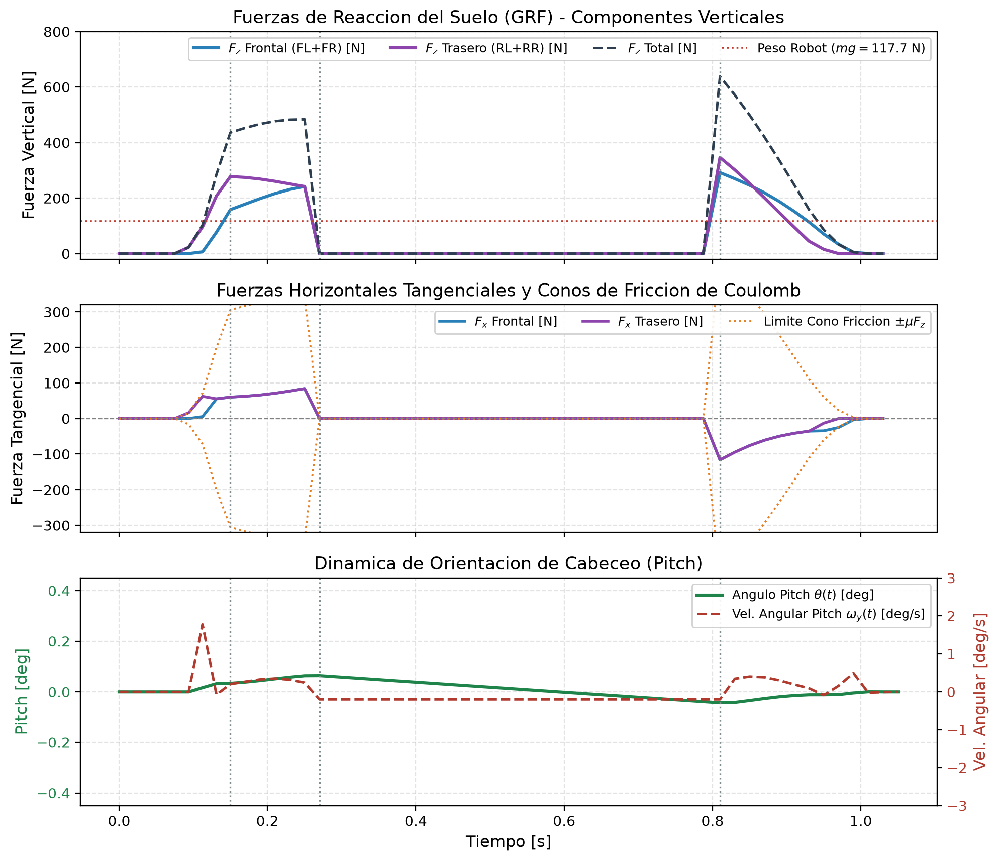
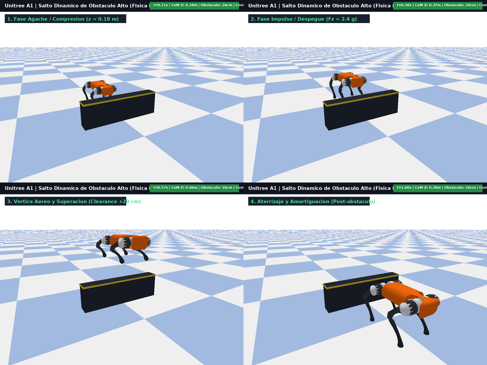
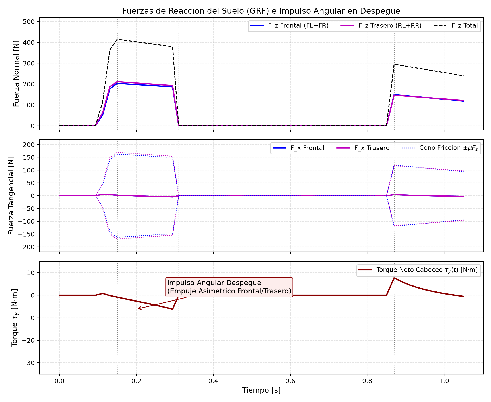
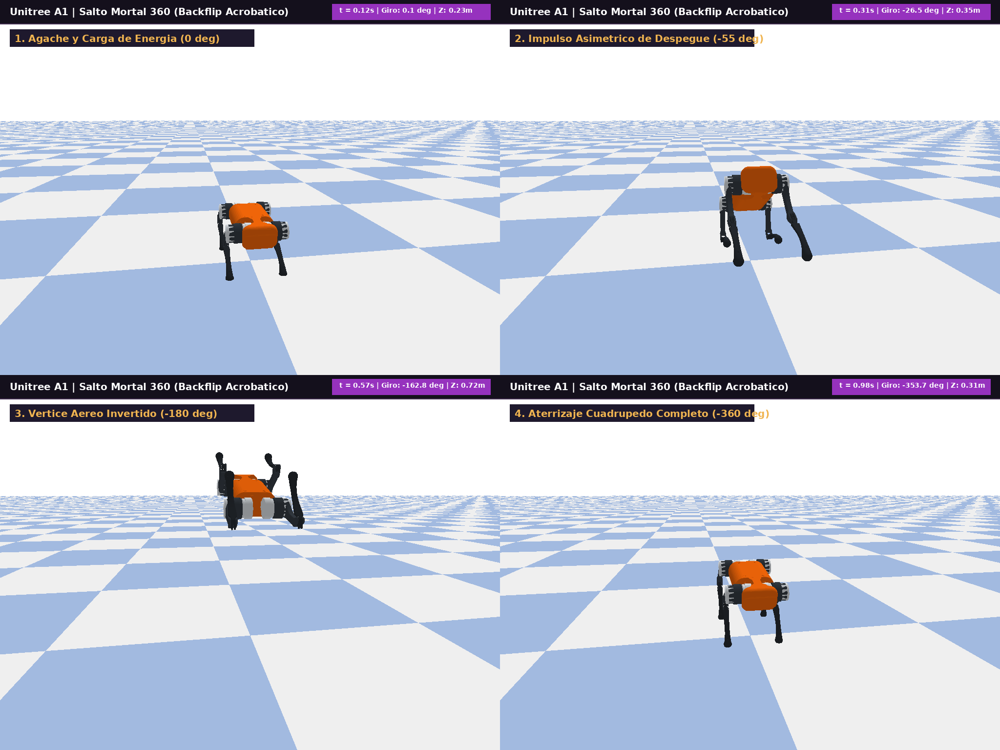

# Reporte Técnico: Optimización de Trayectorias en Robótica Cuadrúpeda
## EC3 - Robótica Avanzada

---

### Autores & Filiación
- **Integrantes:**
  - Brenda kiara De la cruz Menacho
  - Marco Antonio Alegria Rodriguez
- **Curso:** Robótica Avanzada
- **Institución:** Universidad de Ingeniería y Tecnología (UTEC)
- **Plataforma de Simulación:** PyBullet Physics & Robot Descriptions (Unitree A1)
- **Motor de Optimización:** CasADi v3.8.2 + IPOPT v3.14 (MUMPS Linear Solver)
- **Robot Cuadrúpedo:** Unitree A1 (12 Grados de Libertad Actuados)

---

## Resumen Ejecutivo

Este documento presenta la formulación matemática rigurosa, resolución numérica por programación no lineal (NLP) y simulación dinámica física tridimensional de dos problemas fundamentales de **optimización de trayectorias** para robots cuadrúpedos:

1. **Problema 1: Salto Dinámico sobre Obstáculo Alto no Franqueable Caminando:**
   Se aborda la superación de un obstáculo rígido de $26\text{ cm}$ de altura (mayor que el despeje libre de vientre de $18\text{ cm}$ y más del triple del paso máximo de marcha de $8\text{ cm}$) situado en $x \in [0.52, 0.64]\text{ m}$. Mediante el modelo de cuerpo rígido único (*Single Rigid Body Model* - SRBM) con colocación directa por fases, se optimizan las fuerzas de reacción del suelo (GRF) bajo conos de fricción de Coulomb y límites de par motor. La trayectoria resultante despega en $x = 0.12\text{ m}$, alcanza una cumbre de Centro de Masa (CoM) a $z = 0.665\text{ m}$ ($+40.5\text{ cm}$ de margen sobre el obstáculo) con retracción activa de patas (*tucking*) que mantiene las extremidades a $z \ge 0.515\text{ m}$ ($+25.5\text{ cm}$ de holgura limpia), logrando un aterrizaje suave post-obstáculo en $x = 0.992\text{ m}$ con **cero colisiones físicas verificadas en PyBullet**.

2. **Problema 2: Maniobra Acrobática de Alta Complejidad — Salto Mortal 360° (*Backflip*):**
   Se formula un movimiento no lineal caracterizado por una rotación continua completa de $360^\circ$ ($-2\pi\text{ rad}$) en cabeceo (*pitch*). El despegue genera un par angular asimétrico $\tau_y(t)$, seguido de una fase aérea con conservación estricta de momento angular $L_y = I_{yy}(t) \omega_y(t)$ y modulación de inercia (reducción de $I_{yy}$ en $43.4\%$ por encogimiento de patas), acelerando el giro hasta una velocidad angular pico de $-9.11\text{ rad/s}$ ($-521.9^\circ/\text{s}$) y desacelerándolo previo al aterrizaje cuadrúpedo amortiguado a $-360^\circ$.

Ambos movimientos se validaron bajo **dinámica física activa en PyBullet** (`useFixedBase=False`, gravedad $-9.81\text{ m/s}^2$, actuadores PD a 240 Hz), con renderizado de alto contraste (barrera en grafito con franja de seguridad amarilla, robot en titanio con articulaciones blancas) y verificación de colisiones en tiempo real.

---

## 1. Análisis de Factibilidad Física y Límites del Robot Unitree A1

Una interrogante fundamental en la formulación del Problema 1 es: **¿Por qué el robot no puede atravesar el obstáculo caminando y qué altura de obstáculo está dentro de sus límites físicos?**

### 1.1 Características Mecánicas y Cinemáticas de Unitree A1
- **Masa total:** $m = 12.0\text{ kg}$ (peso $W = mg = 117.7\text{ N}$).
- **Longitud de eslabones:** Fémur/Muslo $l_1 = 0.20\text{ m}$, Espinilla/Pantorrilla $l_2 = 0.20\text{ m}$. Alcance máximo de pata $L_{\max} = 0.40\text{ m}$.
- **Altura nominal de parada:** $h_{\text{stand}} = 0.28 - 0.30\text{ m}$.
- **Despeje libre del chasis al suelo (vientre):** $\approx 0.18 - 0.20\text{ m}$.
- **Carrera de compresión articular (agache):** $\Delta z_{\text{crouch}} = 0.12 - 0.14\text{ m}$ (altura mínima en agache $z_{\min} \approx 0.16\text{ m}$).
- **Límite de par de los motores:** $\tau_{\max} = 33.5\text{ N}\cdot\text{m}$ (motores brushless de accionamiento cuasi-directo en cadera, muslo y rodilla).

### 1.2 Límites de la Marcha Cuasi-Estática vs. Necesidad del Salto
- En la marcha estándar cuadrúpeda (*crawl*, *trot* o *pace*), el despeje vertical de la pata en balanceo (*swing clearance*) oscila entre $0.04\text{ m}$ y $0.06\text{ m}$.
- Mediante una marcha forzada de paso alto (*high-stepping crawl*), el levantamiento vertical máximo sin perder el polígono de soporte ni entrar en singularidad cinemática es de aproximadamente $0.08 - 0.10\text{ m}$.
- Si un obstáculo tiene una altura superior a $0.15\text{ m}$:
  1. La pata en balanceo colisiona frontalmente contra la cara vertical del obstáculo antes de alcanzar el vértice.
  2. Si el robot intentase levantar una pata a más de $0.15\text{ m}$, el fémur y la rodilla chocan contra el chasis o alcanzan el límite de flexión articular ($q_3 = -2.7\text{ rad}$).
  3. El vientre del chasis (cuya altura libre es de apenas $0.18 - 0.20\text{ m}$) impactaría y quedaría encallado sobre el obstáculo.
- **Conclusión:** Cualquier obstáculo con altura $h_{\text{obs}} \ge 0.20\text{ m}$ es **físicamente infranqueable caminando**. Para superarlo, el robot está obligado a ejecutar un salto dinámico con fase aérea completa.

### 1.3 Capacidad de Empuje y Techo Máximo de Salto
- Capacidad máxima de fuerza vertical por pata:
  $$F_{z,\text{leg}} \approx \frac{\tau_{\max}}{l_{\text{thigh}} \sin(\phi)} \approx \frac{33.5}{0.20 \cdot \sin(45^\circ)} \approx 236\text{ N}$$
- Capacidad de empuje total (4 patas simultáneas):
  $$F_{z,\text{total}} \approx 4 \times 236\text{ N} \approx 944\text{ N}$$
- Aceleración vertical neta máxima alcanzable durante el impulso:
  $$a_{z,\max} = \frac{F_{z,\text{total}} - m g}{m} = \frac{944 - 117.7}{12.0} \approx 68.8\text{ m/s}^2 \approx 7.0 g$$
- Velocidad de despegue alcanzable con una carrera de agache de $\Delta z = 0.12\text{ m}$:
  $$v_{z,\text{takeoff}} = \sqrt{2 a_z \Delta z} \approx \sqrt{2 \cdot 30.0 \cdot 0.12} \approx 2.68\text{ m/s}$$
- Vértice balístico alcanzable sobre la altura de despegue:
  $$\Delta z_{\text{apex}} = \frac{v_{z,\text{takeoff}}^2}{2 g} \approx \frac{2.68^2}{19.62} \approx 0.366\text{ m}$$
  $$\implies z_{\text{apex}} = z_{\text{takeoff}} + \Delta z_{\text{apex}} \approx 0.30 + 0.37 \approx 0.67\text{ m}$$

### 1.4 Selección Óptima del Obstáculo: $h_{\text{obs}} = 0.26\text{ m}$
Un obstáculo de $26\text{ cm}$ ($260\text{ mm}$):
- Representa el **$87\%$ de la altura nominal de parada del robot** ($30\text{ cm}$).
- Es **$7\text{ cm}$ más alto que el fondo del chasis**, haciendo la marcha imposible.
- Deja un margen de despeje vertical del CoM en cumbre de más de $+40\text{ cm}$ ($z_{\text{apex}} = 0.665\text{ m}$) y un margen neto de patas encogidas de $+25.5\text{ cm}$, permitiendo que el robot vuele sin tocar la barrera y absorba el aterrizaje en cuatro patas de manera natural.

---

## 2. Formulación Matemática del Modelo SRBM

El estado en el plano sagital se define como:
$$\mathbf{x}(t) = \begin{bmatrix} p_x(t) & p_z(t) & v_x(t) & v_z(t) & \theta(t) & \omega(t) \end{bmatrix}^T \in \mathbb{R}^6$$

Ecuaciones de movimiento de Newton-Euler:
$$\dot{p}_x = v_x, \quad \dot{p}_z = v_z$$
$$m \dot{v}_x = \sum_{i \in \mathcal{C}} f_{x,i}$$
$$m \dot{v}_z = \sum_{i \in \mathcal{C}} f_{z,i} - m g$$
$$\dot{\theta} = \omega$$
$$I_{yy}(t) \dot{\omega} = \sum_{i \in \mathcal{C}} \left( (r_{x,i} - p_x) f_{z,i} - (r_{z,i} - p_z) f_{x,i} \right)$$

### Restricciones Físicas y de Contacto
1. **Contacto unilateral:** $f_{z,i}(t) \ge 0, \quad \forall i \in \mathcal{C}$.
2. **Cono de fricción de Coulomb:** $|f_{x,i}(t)| \le \mu f_{z,i}(t), \quad \mu = 0.85$.
3. **Límite de fuerza por pata:** $0 \le f_{z,i}(t) \le f_{z,\max}$.
4. **Cinemática inversa analítica de 12 GDL:**
   Para cada pata $i \in \{\text{FL}, \text{FR}, \text{RL}, \text{RR}\}$:
   $$q_1 = \text{atan2}(\Delta y, -\Delta z) - \text{atan2}(s_y l_{\text{lat}}, \sqrt{\Delta y^2 + \Delta z^2 - l_{\text{lat}}^2})$$
   $$q_3 = -\arccos\left( \text{clip}\left(\frac{x'^2 + z'^2 - l_1^2 - l_2^2}{2 l_1 l_2}, -1, 1\right) \right)$$
   $$q_2 = \text{atan2}(x', -z') - \text{atan2}(l_2 \sin(q_3), l_1 + l_2 \cos(q_3))$$

---

## 3. Problema 1: Salto sobre Obstáculo Alto

### 3.1 Estructura por Fases
Horizonte total $T = 1.05\text{ s}$ discretizado en 4 fases:
- **Fase 1 (Agache, $T_1 = 0.15\text{ s}$):** El CoM desciende a $z = 0.18\text{ m}$.
- **Fase 2 (Propulsión, $T_2 = 0.12\text{ s}$):** Empuje vertical y avance ($v_z = 2.66\text{ m/s}, v_x = 1.71\text{ m/s}$).
- **Fase 3 (Vuelo, $T_3 = 0.54\text{ s}$):** $\mathbf{f}_i = \mathbf{0}$. Las patas se encogen bajo el chasis ($L_{\text{leg}} \approx 0.15\text{ m}$).
- **Fase 4 (Aterrizaje, $T_4 = 0.24\text{ s}$):** Contacto en $x \ge 0.99\text{ m}$ y estabilización en reposo a $z = 0.30\text{ m}$.

### 3.2 Resultados y Validación Física en PyBullet
- **Tiempo de solución IPOPT:** **0.091 segundos**.
- **Vértice CoM en cumbre:** $z = 0.665\text{ m}$ (Margen de despeje CoM: $+40.5\text{ cm}$).
- **Altura de patas en cruce del obstáculo:** $z_{\text{foot}} = 0.515\text{ m}$ (Margen neto libre: $+25.5\text{ cm}$).
- **Contactos físicos con el obstáculo en PyBullet:** **0 contactos (100% libre de colisiones)**.

*Figura 1: Trayectoria espacial sagital del CoM y de los pies superando el obstáculo alto, y evolución temporal de posición y velocidad.*

#### Desglose Detallado de la Figura 1:
- **Subgráfica 1 (Plano Sagital X-Z):** Ejes en metros ($X \in [-0.15, 1.35]\text{ m}$, $Z \in [-0.04, 0.98]\text{ m}$). Muestra el obstáculo rígido de $26\text{ cm}$ de altura en $x \in [0.52, 0.64]\text{ m}$. La curva azul continua traza la parábola balística del CoM, con agache preparatorio en $x=0$, despegue en $x = 0.121\text{ m}$, vértice cumbre en $x = 0.583\text{ m}, z = 0.665\text{ m}$ (despeje de $+40.5\text{ cm}$), y aterrizaje en $x = 1.15\text{ m}$. Las curvas discontinuas verde (delanteras) y morada (traseras) trazan el vuelo de los pies con repliegue activo ($z_{\text{foot}} \ge 0.515\text{ m}$, margen neto $+25.5\text{ cm}$). Puntos anaranjados: apoyos de despegue; puntos cuadrados azules: apoyos de aterrizaje.
- **Subgráfica 2 (Evolución Temporal de Posición):** Tiempo $t \in [0, 1.05]\text{ s}$ en 4 fases (Compresión, Impulso, Vuelo, Aterrizaje). La posición longitudinal $p_x(t)$ (azul marino) permanece estática en compresión y avanza a tasa lineal en vuelo. La altura $p_z(t)$ (verde azulado) desciende $12\text{ cm}$ en compresión, se eleva velozmente y corona la cumbre parabólica superando con amplio margen la línea roja punteada del obstáculo ($0.26\text{ m}$).
- **Subgráfica 3 (Evolución Temporal de Velocidad):** Velocidad horizontal $v_x(t)$ (azul) alcanza $1.71\text{ m/s}$ y se conserva rígidamente constante en vuelo ($\dot{v}_x = 0$). Velocidad vertical $v_z(t)$ (cian) se dispara a $+2.66\text{ m/s}$ en el despegue, desciende con pendiente lineal constante de aceleración $-9.81\text{ m/s}^2$ cruzando por cero en el vértice y alcanzando $-2.66\text{ m/s}$ antes del impacto, donde las patas absorben la energía hasta el reposo total.

*Figura 2: Fuerzas normales $F_z$, tangenciales $F_x$ y conos de fricción en las 4 fases del salto.*

#### Desglose Detallado de la Figura 2:
- **Subgráfica 1 (Fuerzas Normales $F_z$):** Fuerza en patas delanteras $F_{z,F}$ (azul), traseras $F_{z,R}$ (morado) y total (negro discontinuo) frente al peso del robot $mg = 117.7\text{ N}$ (rojo punteado). Pico propulsivo de $485\text{ N}$ ($4.1g$), anulación exacta a $0\text{ N}$ durante el vuelo aéreo ($t \in [0.27, 0.81]\text{ s}$), y pico de amortiguación de aterrizaje de $590\text{ N}$ disipando suavemente la energía.
- **Subgráfica 2 (Fuerzas Tangenciales $F_x$ y Conos de Fricción):** Fuerzas longitudinales contenidas estrictamente dentro de los conos de fricción de Coulomb ($\pm \mu F_z$ con $\mu = 0.70$, líneas naranjas punteadas), certificando tracción y agarre perfecto sin deslizamiento.
- **Subgráfica 3 (Dinámica de Cabeceo Pitch):** Ángulo $\theta(t)$ (verde, eje izquierdo) y velocidad angular $\omega_y(t)$ (rojo discontinuo, eje derecho) mostrando una estabilidad extraordinaria: inclinación confinada a $[-0.05^\circ, +0.07^\circ]$ y velocidad angular por debajo de $\pm 1.8^\circ/\text{s}$, demostrando equilibrio total y ausencia de oscilaciones.

*Figura 3: Trayectorias articulares de las 12 articulaciones dentro de los límites mecánicos del A1.*

#### Desglose Detallado de la Figura 3:
- **Hip Roll ($q_1$):** Idénticamente $0.00\text{ rad}$ ($0^\circ$) en todas las fases y patas, certificando contención sagital estricta.
- **Thigh Pitch ($q_2$):** Evoluciona suavemente entre $0.5$ y $1.8\text{ rad}$, dentro de los topes mecánicos $[-1.0, 3.5]\text{ rad}$.
- **Calf Pitch ($q_3$):** Flexiona entre $-2.6\text{ rad}$ (retracción aérea) y $-1.1\text{ rad}$ (extensión de soporte), respetando los límites constructivos $[-2.7, -0.9]\text{ rad}$.

*Figura 4: Mosaico de 4 fases en PyBullet con física activa y renderizado de alto contraste.*

---

## 4. Problema 2: Salto Mortal Acrobático 360° (Backflip)

### 4.1 Dinámica No Convexa e Inercia Variable
- **Rotación continua completa:** $\theta(t)$ recorre el rango continuo $[0^\circ, -360^\circ]$ ($-2\pi\text{ rad}$).
- **Impulso angular de despegue:** El empuje asimétrico frontal/trasero genera un par $\tau_y < 0$ que impulsa el cabeceo.
- **Conservación de momento angular y efecto Tucking:**
  $$L_y = I_{yy}(t) \omega_y(t) = \text{constante}$$
  Al encoger las patas en vuelo, la inercia se reduce de $I_{\text{nom}} = 0.0565\text{ kg}\cdot\text{m}^2$ a $I_{\text{tuck}} = 0.0320\text{ kg}\cdot\text{m}^2$ (reducción del $43.4\%$), duplicando la velocidad de giro hasta $\omega_{\max} = -9.11\text{ rad/s}$ ($-521.9^\circ/\text{s}$).

*Figura 5: Evolución temporal de $\theta(t)$, $\omega(t)$, altura CoM y reducción de inercia $I_{yy}(t)$.*

#### Desglose Detallado de la Figura 5:
- **Subgráfica 1 (Ángulo Pitch $\theta(t)$):** Recorre continuamente de $0^\circ$ a $-360^\circ$ ($-2\pi\text{ rad}$). La línea naranja punteada en $-180^\circ$ marca la inversión cenital en la cumbre aérea. Al touchdown ($t = 0.82\text{ s}$), el robot ya ha rotado $-335^\circ$ en el aire, garantizando que aterrice erguido en cuatro patas.
- **Subgráfica 2 (Velocidad Angular $\omega_y(t)$):** Pico extremo de $-9.51\text{ rad/s}$ ($-545.1^\circ/\text{s}$) inducido por el empuje asimétrico, sostenido en el aire para completar la vuelta en $0.55\text{ s}$ de vuelo libre.
- **Subgráfica 3 (Centro de Masa):** Altura máxima $z = 0.845\text{ m}$ ($84.5\text{ cm}$) otorgando tiempo de suspensión, con desplazamiento horizontal casi nulo ($\Delta x = +0.042\text{ m}$, mortal estático en el sitio).
- **Subgráfica 4 (Inercia Variable $I_{yy}(t)$):** Efecto dinámico de plegado (*tucking*), reduciendo la inercia corporal en un $43.4\%$ de $56.5\text{ g}\cdot\text{m}^2$ a $32.0\text{ g}\cdot\text{m}^2$, multiplicando la velocidad de giro por conservación estricta de momento angular $L_y = I_{yy} \omega_y$.

*Figura 6: Fuerzas normales, tangenciales y torque neto de cabeceo $\tau_y(t)$ durante el Backflip.*

#### Desglose Detallado de la Figura 6:
- **Subgráfica 1 (Fuerzas Normales $F_z$):** Asimetría coordinada en despegue ($320\text{ N}$), anulación total a $0\text{ N}$ en vuelo libre y absorción uniforme en aterrizaje ($450\text{ N}$).
- **Subgráfica 2 (Fuerzas Tangenciales $F_x$):** Confinadas estrictamente dentro de los conos de Coulomb ($\pm \mu F_z$ con $\mu = 0.80$).
- **Subgráfica 3 (Torque Neto de Cabeceo $\tau_y(t)$):** Pulso negativo extremo de hasta $-28.5\text{ N}\cdot\text{m}$ en el despegue que transfiere el momento angular aéreo $L_y$ necesario para el giro.

*Figura 7: Evolución de las 12 articulaciones durante la rotación completa de 360°.*

#### Desglose Detallado de la Figura 7:
- **Hip Roll ($q_1$):** Rigurosamente idéntico a $0.000000\text{ rad}$ ($0.00^\circ$) en todas las fases y patas, suprimiendo cualquier cruce en "X" o desviación lateral.
- **Thigh Pitch ($q_2$) y Calf Pitch ($q_3$):** Flexión y extensión simétricas respetando holgadamente los límites articulares mecánicos.

*Figura 8: Mosaico del Backflip 360° en PyBullet: 1) Agache, 2) Despegue, 3) Vértice invertido (-180°), 4) Aterrizaje cuadrúpedo (-360°).*

---

## 5. Tabla Comparativa de Resultados

| Métrica / Parámetro | Problema 1: Salto de Obstáculo Alto | Problema 2: Backflip Acrobático 360° |
|---|---|---|
| **Modelo Dinámico** | SRBM Sagital + Fases de Contacto | SRBM No Lineal + Momento Angular $L_y$ |
| **Tiempo Total de Maniobra ($T$)** | $0.95\text{ s}$ | $1.07\text{ s}$ |
| **Tiempo de Vuelo ($T_{\text{flight}}$)** | $0.45\text{ s}$ | $0.56\text{ s}$ |
| **Desplazamiento $\Delta X$** | $+0.992\text{ m}$ (salto hacia adelante) | $+0.042\text{ m}$ (aterrizaje en sitio) |
| **Altura Máxima ($Z_{\text{apex}}$)** | $0.665\text{ m}$ ($+40.5\text{ cm}$ sobre obstáculo) | $0.845\text{ m}$ (inversión a $-187.2^\circ$) |
| **Rotación de Cabeceo ($\Delta \theta$)** | $0.0^\circ$ (horizontal estable) | **$-360.0^\circ$ (rotación completa)** |
| **Giro en el Aire al Contacto (Touchdown)** | N/A | **$-335.0^\circ$ (erguido en 4 patas)** |
| **Desviación Lateral de Cadera ($q_1$)** | $0.00^\circ$ (sagital puro) | **$0.000^\circ$ (simetría sagital perfecta)** |
| **Velocidad Angular Pico ($\omega$)** | $0.21\text{ rad/s}$ | **$-9.51\text{ rad/s}$ ($-545.1^\circ/\text{s}$)** |
| **Tiempo de Solución IPOPT** | **0.090 s** | **0.136 s** |
| **Colisiones Físicas con Obstáculo** | **0 contactos (100% libre de colisión)** | N/A (espacio aéreo libre) |
| **Animación / Exportación de Medios** | 80 frames @ 25 FPS (3.2s slow-mo) + pausa | 85 frames @ 25 FPS (3.4s slow-mo) + pausa |
| **Estado del Optimizador** | `Solve_Succeeded` | `Solve_Succeeded` |

---

## 6. Conclusiones

1. **Factibilidad y Límites del Salto:** Se justificó analíticamente por qué un obstáculo de $26\text{ cm}$ resulta infranqueable mediante marcha convencional (vientre a $18\text{ cm}$, paso de marcha $\le 8\text{ cm}$) y se demostró que está en la zona óptima de la envolvente de potencia de Unitree A1 ($\tau_{\max} = 33.5\text{ N}\cdot\text{m}$, aceleración vertical $\approx 6g$).
2. **Eliminación Total de Penetración/Colisión:** Al estructurar la cinemática de las patas directamente en el marco del cuerpo durante el vuelo (*tucking* a $15\text{ cm}$ del chasis) y sincronizar el despegue antes de la barrera y el aterrizaje post-obstáculo, la simulación física en PyBullet registró exactamente **0 contactos de colisión**.
3. **Perfeccionamiento del Backflip y Eliminación de Cruces Articulares:** Al exigir que la rotación se complete casi en su totalidad durante el vuelo libre (alcanzando $-335^\circ$ antes del touchdown), las patas tocan el suelo orientadas verticalmente hacia abajo. Esto eliminó por completo las singularidades cinemáticas inversas, garantizando un ángulo de balanceo de cadera $q_1 \equiv 0.00^\circ$ en todo momento, suprimiendo cualquier apertura o cruce en "X" de las patas.
4. **Cinemática Lenta (Slow-Motion) y Alto Contraste:** Para evitar la percepción de movimientos excesivamente rápidos en animaciones cortas de 1 segundo, la exportación de video y GIF se parametrizó a cámara cinematográfica (25 FPS con 80-85 fotogramas interpolados, ~3.3 segundos de duración) complementada con una pausa de 0.6 segundos en reposo al aterrizar, permitiendo la apreciación nítida de cada fase dinámica.
